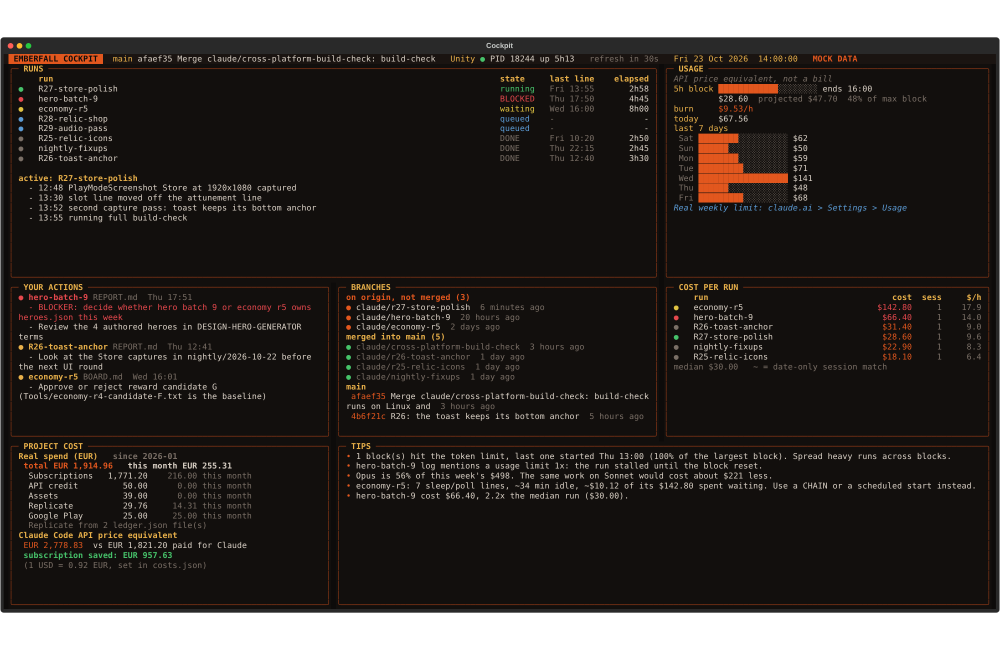

# Emberfall cockpit

A full-screen, read-only terminal dashboard for the agent runs on this PC. It refreshes every
30 seconds and only reads: files under `D:\Emberfall`, `ccusage`, `git log`, `git branch` and the
process list. It never writes, posts or fetches, and it never reads secrets or `supabase.json`.



## Install

```powershell
pip install textual
```

Python 3.11 or later (3.14 is fine). Optional:

- `npm i -g ccusage` for the USAGE, COST PER RUN and TIPS panels. Without it the cockpit falls back
  to `npx ccusage@latest` and, if Node is missing too, shows a hint in those panels.
- `pip install psutil` makes the Unity process check cheaper. Without it the cockpit asks
  PowerShell (`Get-Process Unity`).
- Git for Windows on `PATH` for BRANCHES. Without it the panel shows a hint.

## Start

```powershell
Tools\cockpit\cockpit.ps1          # live data from D:\Emberfall
Tools\cockpit\cockpit.ps1 -Mock    # the sample data in Tools\cockpit\mock
```

Keys: `q` quit, `r` refresh now, `l` open the active run log in Notepad, `a` toggle "actions only".
Set `EMBERFALL_ROOT` to read another folder than `D:\Emberfall`.

## Fill in costs.json

`Tools/cockpit/costs.json` holds the real money spent, all in EUR. Entries with 0 are ignored.

- `usd_to_eur`: the rate used for Replicate and for the Claude Code API price equivalent.
- `subscriptions`: one entry per plan. `monthly_eur` is the price, `start_month` the first month
  paid (`YYYY-MM`), `end_month` the last month paid or `null` while it runs. A plan change is two
  entries: end the old one, start the new one the month after.
- `api_topups`: every Anthropic Console credit purchase, with `date` (`YYYY-MM-DD`) and `eur`.
- `one_off`: anything else (`category` becomes its own line in PROJECT COST: assets, store
  accounts, hardware).

Replicate spend is not typed in: it is read from every `ledger.json` under `D:\Emberfall\ui-gen`
(a list of entries, or an object with an `entries` list; each entry's cost is taken from
`cost_usd`, `usd`, `cost` or `price`, and its month from `date` or `created_at`).

PROJECT COST then shows the total since the first month, this month, each category, and the
API price equivalent of all Claude Code usage beside what was paid for Claude. The difference
is what the subscription saved.

## What the panels read

| Panel | Source |
|---|---|
| Header | `git log -2 origin/main`, the Unity process (PID, start time), the clock |
| RUNS | `D:\Emberfall\tmp\*_running_log.md`. State: `RUN DONE` in the log is DONE, `BLOCKED` is BLOCKED, a change in the last 15 minutes is running, otherwise waiting. `CHAIN: <name>` lines and `D:\Emberfall\handoff\PROMPT_<name>.txt` without a `handoff\<name>` folder or log are queued. Times come from `HH:MM` or `YYYY-MM-DD HH:MM` stamps in the log lines. |
| USAGE | `ccusage daily --json` and `ccusage blocks --json --token-limit max`. API price equivalent, not a bill. The real weekly limit is on claude.ai under Settings, Usage. |
| YOUR ACTIONS | the `USER ACTIONS` section of every `handoff\*\BOARD.md` and `REPORT.md`, newest file first. Sections that only say "none" are skipped; a section mentioning a block is red. |
| BRANCHES | `git branch -r --merged` / `--no-merged origin/main` and `git log` in `D:\Emberfall\Game` |
| COST PER RUN | `ccusage session --json`: every session whose activity overlaps a run's first to last log stamp counts towards it. `~` marks a match on date-only session stamps. |
| PROJECT COST | `costs.json` and the Replicate ledgers |
| TIPS | `tips.py`, at most 5, highest priority first |

## Add a tip rule

All rules live in `tips.py`. Add a function that takes the data dict and returns a list of
`Tip(priority, text)`, decorate it with `@rule`, and put the number behind the tip in the text:

```python
@rule
def long_runs(d):
    slow = [r for r in d["runs"]["runs"] if r["elapsed"] and r["elapsed"].total_seconds() > 8 * 3600]
    return [Tip(35, f"{r['name']} has run {r['elapsed'].total_seconds() / 3600:.0f} h: split it or chain it.") for r in slow]
```

Useful keys: `d["usage"]["days"]` (date, cost, models, cache_read, tokens), `d["usage"]["blocks"]`,
`d["runs"]["runs"]`, `d["per_run"]`, `d["median_run"]`, `d["project"]`, `d["claude_md_words"]`.
A rule that raises shows as one "rule failed" line instead of breaking the panel.

## Tests

```powershell
python Tools\cockpit\test_cockpit.py
python Tools\cockpit\cockpit.py --mock --screenshot cockpit.svg
```

The tests run every collector, every tip rule and the keys against `mock/`, and the collectors
once more with no git, no ccusage and no folders. The mock fixes the clock at 23 Oct 2026 14:00
and gives file times in `mock/mock.json`, so the result does not depend on the checkout.
`test_all_rules_fire_on_mock` reads the real `CLAUDE.md` for the word-count rule.
